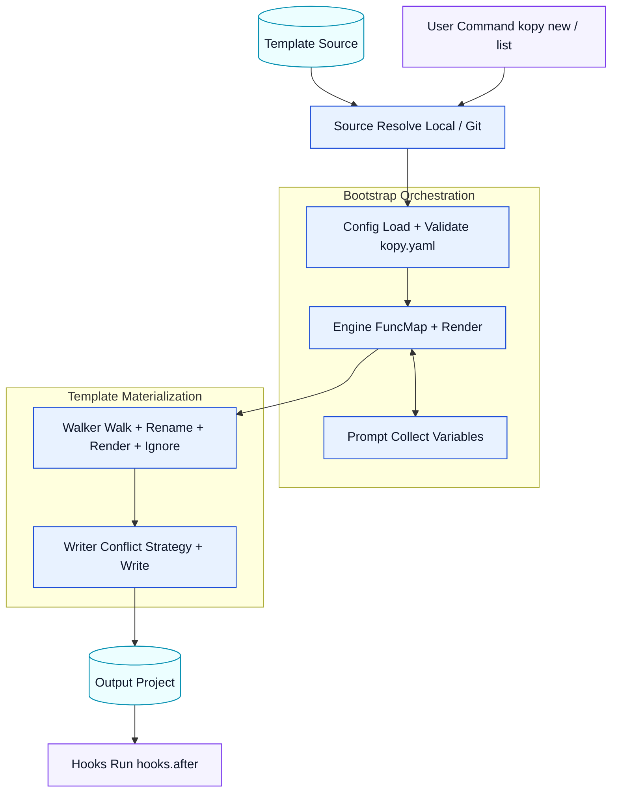

# 架构与执行流程 | Architecture and pipeline

> kopy 分成 source / config / engine / prompt / walker / writer 六层，每层职责单一、可独立替换。
> 这份文档说明各层怎么串起来，以及写入阶段的冲突与权限处理。

> [EN] kopy is layered into source, config, engine, prompt, walker and writer. Each layer has
> a single responsibility and can be swapped independently. This document covers how they
> connect and how the write stage handles conflicts and permissions.

## 🏗️ 架构图 | Architecture

## 🧩 执行流程与扩展点 | Pipeline and extension points

1. **源解析** `source/` — 判断本地路径或 Git 仓库，Git 自动克隆到临时目录
2. **配置加载** `config/` — 读取并校验 `kopy.yaml`
3. **变量收集** `prompt/` — 交互式收集，`--var` / `--yes` 可跳过；每答一题写回引擎
4. **模板渲染** `engine/` — `text/template` 渲染内容与路径
5. **目录遍历** `walker/` — 递归遍历，依次应用 rename → 渲染 → ignore
6. **文件写入** `writer/` — 冲突检测、权限判定、写入或试运行
7. **初始化** `bootstrap/hooks.go` — 渲染并执行 `hooks.after`

每层职责单一，可独立替换：`source/` 可扩展 S3 / OCI Registry，`engine/` 可扩展函数或定界符，
`prompt/` 可替换为 TUI，`writer/` 可扩展冲突策略。

[EN] Each layer has a single responsibility and can be swapped independently.

## 🛡️ 冲突处理策略 | Conflict strategy

| 策略 \| Strategy | 参数 \| Flag | 说明 \| Description |
| --- | --- | --- |
| `ask` | 默认 | 交互式询问是否覆盖 |
| `overwrite` | `--overwrite` | 强制覆盖所有已存在文件 |
| `skip` | `--skip` | 跳过所有已存在文件 |

写入器会检测内容是否以 shebang（`#!`）开头，是则按 `0755` 写入，否则 `0644`。

[EN] The writer checks for a leading shebang and writes `0755` when present, `0644` otherwise.
